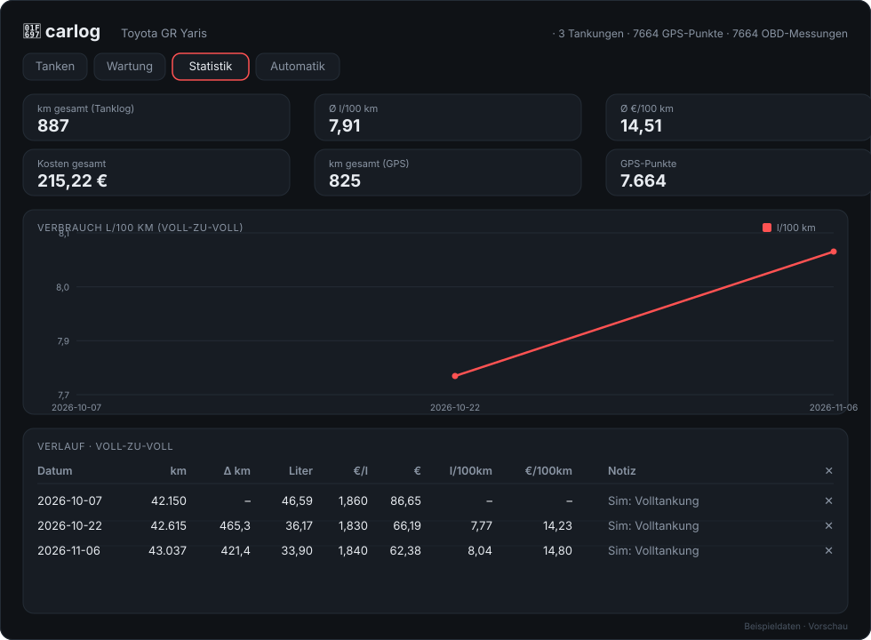

<div align="center">

# 🚗 carlog

**Selbst gehosteter Fahrzeug-Tracker – Tanken, Wartung & Telemetrie.**

Ein Container auf dem eigenen Server, alle Daten in **einer** SQLite-Datei.
Keine Cloud, keine pip-Pakete, nichts, was irgendwohin telefoniert.

[](server.py)
[](https://sqlite.org)
[](docker-compose.yml)
[](https://github.com/Skrockle/carlog#setup-auf-dem-tower)
[](#)
[](#setup-auf-dem-tower)



*Vorschau (Statistik-Ansicht) mit Beispieldaten — das echte UI läuft komplett lokal unter `http://TOWER-IP:8077`.*

</div>

## Features

- ⛽ **Tanklog** mit Voll-zu-Voll-Verbrauch: l/100 km, €/100 km, €/Monat — serverseitig gerechnet, Teilfüllungen werden erst beim nächsten Volltanken verrechnet
- 🔧 **Wartungshistorie** mit km-Stand, Kosten und Notizen
- 📍 **Automatischer GPS-Ingest** (`/api/gps`) — kompatibel mit GPSLogger/OsmAnd/Traccar → km/Monat und Jahresleistung ohne Zutun
- 🚗 **OBD2-Ingest** (`/api/obd`) im Torque-Webserver-Format → Drehzahl, Kühl-/Ansaugtemperatur, Bordspannung (12V-Frühwarnung!)
- 📊 **Statistik-Tab** mit SVG-Charts — ohne externe JS-Libs, kein CDN
- 📱 **Dunkles, deutschsprachiges Web-UI**, PWA-fähig („Zum Homescreen“)
- 📤 **CSV-Export** für alle Datenarten · 🔐 optionaler **Token-Schutz** für schreibende Endpunkte

## Was macht Sinn zu tracken (GR Yaris, Benziner)

| Was | Wie | Automatisch? |
|---|---|---|
| Verbrauch l/100 km, €/100 km, €/Monat | Tanklog (immer voll, Liter + Preis + km) | nein – 2 Taps im Formular |
| Wartungshistorie, Reifen-Lebensdauer | Wartungs-Formular | nein – kurz eintragen |
| km/Monat, Fahrten, Jahresleistung | GPS-Logger-App → `/api/gps` | **ja** |
| Drehzahl, Kühl-/Öltemperatur, 12V-Spannung | OBD2-Dongle + Torque Pro → `/api/obd` | **ja** |
| Rohdaten für spätere Auswertung | bleiben in SQLite/CSV | – |

Nicht ohne Cloud möglich: Tankfüllung selbst (kein Tanksensor ohne Hardware-Umbau)
und Toyota-myT-Daten – bewusst weggelassen, weil Cloud.

## Setup auf dem Tower

1. Repo/Ordner nach `/mnt/user/appdata/carlog-src` (oder beliebig) legen.
2. `docker compose up -d` (Unraid ≥ 7 hat Compose integriert) **oder** CA →
   „Add Container“: Image `carlog:latest` aus lokalem Build, Port `8077:8077`,
   Volume `/mnt/user/appdata/carlog:/data`.
3. Öffnen: `http://TOWER-IP:8077` → am Handy „Zum Homescreen“ (PWA-fähig).

Backup: nur die Datei `/mnt/user/appdata/carlog/carlog.db` sichern – fertig.

## Automatische Erfassung einrichten

### km/Strecken – GPSLogger (FOSS, F-Droid/Play Store)
- Einstellungen → Logging-Details → *Log to custom URL*:
  `http://TOWER-IP:8077/api/gps?lat=%LAT&lon=%LON&timestamp=%TIMESTAMP&s=%SPD&alt=%ALT&id=GRYaris&battery=%BATT`
- „Start on boot“ + Bewegungserkennung aktivieren → das Handy loggt automatisch
  mit, wenn gefahren wird. Daraus entstehen km/Monat, Jahresleistung und der
  Kurzstrecken-Anteil.

### Motor-/Batteriewerte – Torque Pro (oder Car Scanner)
- OBD2-Bluetooth/WiFi-Dongle an den GR Yaris (Steckdose unter dem Lenkrad).
- Torque Pro → Einstellungen → Datenlogging → *Log to webserver*:
  `http://TOWER-IP:8077/api/obd?id=GRYaris`
  (Torque hängt `time`, `session` und alle PIDs selbst an.)
- Praktisch für den GR Yaris: Bordspannung (12V-Frühwarnung), Kühlwassertemperatur,
  Ladeluft-/Ansaugtemperatur – die Ts-Werte landen roh in `obd_readings` und per CSV-Export.

Optional TOKEN in der compose setzen → dann `?token=...` an alle schreibenden
Endpunkte und Ingest-URLs anhängen.

## API (kurz)

| Endpunkt | Zweck |
|---|---|
| `GET /api/health` | Status |
| `GET/POST/DELETE /api/fillups` | Tanklog (Verbrauch wird serverseitig gerechnet) |
| `GET/POST/DELETE /api/maintenance` | Wartung |
| `GET /api/stats` | Gesamt- + Monatswerte (Tanklog + GPS) |
| `GET /api/gps?lat=&lon=&timestamp=&s=&id=` | GPS-Ingest (OsmAnd/GPSLogger/Traccar-Protokoll) |
| `GET /api/obd?time=&session=&id=&v<pid>=` | OBD-Ingest (Torque-Format) |
| `GET /api/telemetry?kind=obd\|gps&limit=N` | letzte Rohwerte |
| `GET /api/export.csv?kind=fillups\|maintenance\|gps\|obd` | CSV-Export |

## Entwicklung

Lokal ohne Docker:
```sh
CARLOG_DB=./carlog.db python3 server.py   # -> http://127.0.0.1:8077
```
