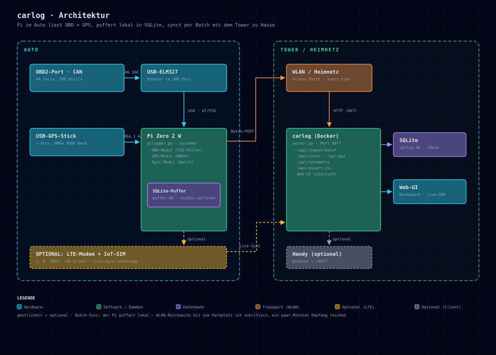

# carlog – Ausbauplan: Pi-Reader im Auto (v4)

Status: **verabschiedet** (Nov 2026). Umsetzung: **P1+P2 fertig** (E2E getestet, CI grün), P3–P5 offen (Hardware). Release: **v1.0.0** — Docker-Image `ghcr.io/skrockle/carlog`.

## Ziel

Ein **Raspberry Pi im Auto** ist der eigentliche Reader: Er liest OBD2 (Standard- + Toyota-Enhanced-PIDs)
und GPS, **puffert alles lokal in SQLite** und synchronisiert per Batch, sobald er das Heim-WLAN sieht —
oder optional per LTE (IoT-SIM), wenn unterwegs live gesendet werden soll. Das Handy ist **kein
Pflicht-Teil** mehr (nur optional als Browser-Anzeige).

## Hardware

| Komponente | Kosten (ca.) | Status |
|---|---|---|
| Raspberry Pi Zero 2 W + SD-Karte | ~25 € | zu kaufen |
| USB-ELM327-Adapter | ~12 € | zu kaufen |
| USB-GPS-Stick (u-blox NEO) | ~20 € | zu kaufen |
| **Optional:** LTE-Modem (USB) + IoT-SIM (z. B. 1NCE) | ~20–30 € + ~10 €/Jahr | optional – Live-Sync unterwegs |
| **Optional:** kleines Display (SPI) für den Pi | ~15 € | später |

### Bestellliste (Links)

| # | Teil | Link | ca. |
|---|---|---|---|
| 1 | Raspberry Pi Zero 2 W | <https://www.amazon.de/dp/B09KLVX4RT> | 20–25 € |
| 2 | microSD 16–32 GB (falls nicht da) | beliebige Class-10 | ~6 € |
| 3 | USB-ELM327 (USB, nicht Bluetooth!) | <https://www.amazon.de/s?k=obd2+usb+adapter+elm327> | 10–15 € |
| 4 | USB-GPS u-blox VK-162 — [Stemedu 10 Hz](https://www.amazon.de/dp/B07LBWF1P7) oder [DIYmalls](https://www.amazon.de/dp/B07GS8T3HJ) | wird am Pi als /dev/ttyACM0 erkannt | 15–22 € |
| 5 | OBD2 Y-Splitter (mit Schalter: [Duttek](https://www.amazon.de/dp/B0CGJ9Y3WH), Alternativen ab 8 €) | teilt OBD-Port zwischen ELM327 + Strom | 8–15 € |
| 6 | OBD2 → 5V-USB Stromadapter (Dauerplus, Pin 16) | <https://www.amazon.de/s?k=obd2+stromadapter+usb+12v+5v> | 15–25 € |
| 7 | *Optional:* IoT-SIM 1NCE (10 € einmalig, 10 Jahre, 500 MB) | <https://www.1nce.com/en-us/1nce-connect/pricing> | 10 € |
| 8 | *Optional:* USB-LTE-Modem (z. B. Huawei E3372) | <https://www.amazon.de/s?k=huawei+e3372> | 25–35 € |
| 9 | **Micro-USB-OTG-Hub** (PFLICHT — der Zero 2 W hat nur EINEN USB-Port!) | [BerryBase 4-Port-Hub](https://www.berrybase.de/4-port-micro-usb-2.0-otg-hub-schwarz) | ~4 € |
| 10 | *Optional:* Waveshare UPS HAT (C) für Zero (Li-po 1000 mAh, Pogo-Pins, lädt+versorgt gleichzeitig) | <https://waveshare.com/ups-hat-c.htm> | ~15–20 € |
| 11 | *Optional:* micro-USB → USB-C-Adapter (der Zero 2 W hat micro-USB-Strom, kein USB-C) | <https://www.amazon.de/s?k=micro+usb+auf+usb+c+adapter> | ~4 € |

Splitter + Stromadapter zusammen = Pi bleibt im geparkten Auto an Dauerplus; der Daemon schläft per
ATRV-Wache selbst und synct, sobald das Heim-WLAN reicht.

**Hinweise (Stand Nov 2026):**
- Der Pi Zero 2 W hat **zwei micro-USB-Ports** (PWR IN + USB/OTG) — **kein USB-C**. Der OTG-Hub ist Pflicht,
  weil ELM327 und GPS beide an den einen USB-Port müssen (das Datenblatt bestätigt: „Two micro-USB ports,
  one for input power and one for USB On-The-Go").
- **Alternativer Betrieb mit UPS (Design B):** Pi statt an Dauerplus an eine **zündungsgesteuerte Quelle**
  (12V-Steckdose, Verhalten im GR Yaris am Abholtag prüfen) + UPS HAT (C) als Brücke: Zündung aus → der
  Akku trägt den Pi (1000 mAh ≈ 6 h), der Daemon synchronisiert und fährt sauber herunter — **die
  Autobatterie wird nie netto belastet**, und nach dem Shutdown ist alles aus. Benötigt eine kleine
  Daemon-Änderung (bei Stromverlust: Sync → Shutdown statt Schlafmodus).

Entfallene Teile: **Vgate iCar Pro** (war nur für die iPhone-Route nötig — der USB-ELM327 am Pi macht dasselbe)
und **Handy-Apps** (GPSLogger/Traccar/Car Scanner) als Pflichtkomponente.

## Software-Komponenten

**Auto-Seite (Pi):**
- `pi/pilogger.py` — systemd-Daemon (nur Python-Stdlib):
  - **OBD-Modul:** ELM327 über seriell (`/dev/ttyUSB0`) oder TCP (`tcp://host:port` für den Simulator).
    Pollt Standard-PIDs (Drehzahl 010C, Speed 010D, Kühltemp 0105, Ansaugtemp 010F, Motorlast 0104,
    Bordspannung ATRV) und GR-Yaris-Enhanced-PIDs (Öldruck 221074, Getriebetemp 221638, +B 221021).
    Zündungs-Erkennung: Drehzahl 0 / Poll-Fehler → Schlafmodus mit ATRV-Wache.
  - **GPS-Modul:** NMEA (GPRMC/GPGGA) vom u-blox-Stick, 1 Hz.
  - **SQLite-Puffer:** `puffer.db` im selben Schema wie der Batch-Endpunkt — nichts geht verloren.
  - **Sync-Modul:** sobald carlog erreichbar → `POST /api/ingest/batch` (Chunks à 500 Zeilen),
    danach Puffer leeren. Transportunabhängig: WLAN **oder** LTE — der Daemon merkt keinen Unterschied.

**Tower-Seite (Unraid):**
- `server.py`: neuer Batch-Endpunkt `POST /api/ingest/batch` (N GPS-Punkte + M OBD-Messungen in einem Request).
- Web-UI: **Live-OBD-Werte** im Automatik-Tab (letzte Messungen + Alter in Sekunden, Auto-Refresh).
- Test: `test/elm327-sim.py` — **ELM327-Simulator über TCP** mit GR-Yaris-PIDs: die ganze Kette lässt sich
  ohne echtes Auto testen (später auch in CI statt elmulator, da GR-Yaris-spezifisch).

## Datenfluss (Batch-Sync)

1. Zündung an → Pi pollt OBD (5 s) + GPS (1 Hz) → lokaler Puffer
2. Zündung aus / Motor aus → Pi schläft (ATRV-Wache, weckt bei Ladespannung)
3. Heim-WLAN erreichbar → Batch-POST an den Tower → Puffer geleert
4. WLAN-Reichweite bis zum Parkplatz ist **unkritisch**: ein paar Minuten Empfang reichen; sonst
   Access Point am Fenster Richtung Parkplatz (~20–30 €)

## Sammelraten & Speicher (gemessen)

| Was | Takt (Motor läuft) | Größe/Zeile | Volumen/h Fahrt |
|---|---|---|---|
| OBD (PIDs als JSON-Zeile) | 1 Zeile / 5 s = 720/h | ~207 B (JSON 147 B gemessen) | 145 KB |
| GPS-Position | 1 Zeile / 5 s (zykluskoppelt) | ~120 B | 84 KB |
| Tanken/Wartung | manuell | ~120 B | – |
| **Gesamt** | | | **~230 KB/h Fahrt** |

| Fahrt/Tag | pro Tag | pro Monat | pro Jahr |
|---|---|---|---|
| 30 min | 115 KB | 3,4 MB | 41 MB |
| 1 h | 230 KB | 6,7 MB | 82 MB |
| 2 h | 459 KB | 13,5 MB | 164 MB |
| 5 h | 1,1 MB | 33,6 MB | 409 MB |

Puffer-Dauer auf der SD (32 GB → ~70-350 Jahre; 8 GB → ~20-100 Jahre): **Speicher ist nie der
Grund zum Syncen** — Datenfrische und Backup sind es. Der Sync läuft zeitbasiert: alle 60 s
(`PILOG_SYNC_INTERVAL`) ein Versuch (`GET /api/health`, 4-s-Timeout); erreichbar → Flush in
~80-KB-Chunks (500 Zeilen/Request, max. 40 Requests pro Durchlauf), nicht erreichbar → weiter puffern.
GPS folgt dem Zyklustakt (5 s), nicht dem 1-Hz-Modultakt — für km/Monat via Haversine ausreichend.

## GR-Yaris-PIDs (Recherche)

Quellen: [gr-yaris.co.uk „Reverse engineering PIDs"](https://www.gr-yaris.co.uk/threads/reverse-engineering-pids.4680),
[2m.lt](https://2m.lt/blog/reverse-engineering-pids), [2m/gry-obd-pids](https://github.com/2m/gry-obd-pids).

| Wert | PID (Header 700/7C0) | Formel |
|---|---|---|
| Drehzahl | 010C | ((A·256)+B)/4 |
| Geschwindigkeit | 010D | A |
| Kühlmitteltemp | 0105 | A−40 |
| Ansauglufttemp | 010F | A−40 |
| Bordspannung (ELM) | ATRV | V |
| Öldruck Motor | 221074 | ((A·256)+B)/1280 bar |
| Getriebeöl-Temp | 221638 | A+B/256−40 °C |
| +B Bordspannung | 221021 | A/10 V |
| Ladedruck (Intake MAP) | 221F87 | Formel noch offen |

Motoröl-Temp ist nicht bestätigt. **Am Abholtag prüfen:** Support-Bitmuster 0100/0120/0140/0160 lesen,
Enhanced-PIDs plausibilisieren (Getriebetemp warm ~50–55 °C, +B 12,2 V Zündung an / ~14,2 V laufend,
Öldruck Leerlauf warm 0,9–1 bar).

## Entscheidungen

- **Batch-Sync statt Live:** lokaler Puffer verliert nichts; WLAN-Lücken sind egal.
- **Meshtastic verworfen** (für diesen Zweck): Best-Effort ohne Verlustgarantie, winzige LoRa-Bandbreite
  (EU-Duty-Cycle < 1 %), ~40–60 € Zusatzhardware, nur brauchbar wenn der Parkplatz in Meshweite liegt.
- **IoT-SIM als Option aufgenommen:** LTE-Modem + 1NCE (~10 €/Jahr) direkt am Pi — der Daemon sync't
  transportunabhängig, kein Code-Unterschied zu WLAN.
- **ESP32 verworfen (für v1):** kein USB-Host — der USB-ELM327 passt nicht (TTL-Modul + Umlötung nötig),
  der getestete Python-Daemon müsste in C++ neu gebaut werden, kein echtes SQLite (SPIFFS-Wear im 5-s-Takt).
  Dafür wäre er im Tiefschlaf ~100x sparsamer: Pi-Zero-Standby ~14 Wh/Tag = 432 Wh/Monat = 60 % einer
  60-Ah-Batterie. Bei täglichem Fahren unkritisch (Lichtmaschine lädt 14 Wh/Tag locker nach); für
  mehrwöchiges Parken den Y-Splitter-Schalter nutzen. Falls Energie später doch zum Thema wird: ESP32
  als „Wächter" v2 (aufwachen, ATRV prüfen, Sync-Versuch, weiterschlafen).
- **Grafana-Anbindung**: zwei Wege — (A) **Infinity-Plugin über die API**
  (`/api/series.csv?kind=<wert>`, kein Volume-Mapping nötig, Quelle netzwerk-erreichbar; Kinds: 10 OBD-Werte,
  gps_speed, fillup_cost) oder (B) SQLite-Datenquelle bei Volume-Mapping (WAL-Modus, fertiges Dashboard
  `docs/grafana-dashboard.json`).
- **Vgate entfallen:** USB-ELM327 am Pi deckt alles ab.

## Phasen

| Phase | Inhalt | Status |
|---|---|---|
| P1 | carlog-Batch-Endpunkt `/api/ingest/batch` | **fertig** |
| P2 | Pi-Daemon `pilogger.py` + ELM327-Simulator, E2E gegen Simulator | **fertig** (CI grün) |
| P3 | Hardware bestellen & aufbauen, systemd-Unit auf dem Pi | offen |
| P4 | Abholtag-Verifikation (Support-Bitmuster + Enhanced-PIDs) | offen |
| P5 | Optional: LTE-Modem + IoT-SIM für Live-Sync unterwegs | offen |
